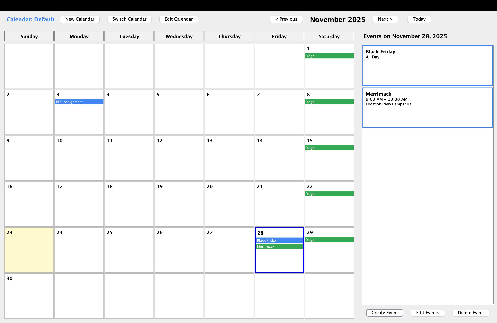
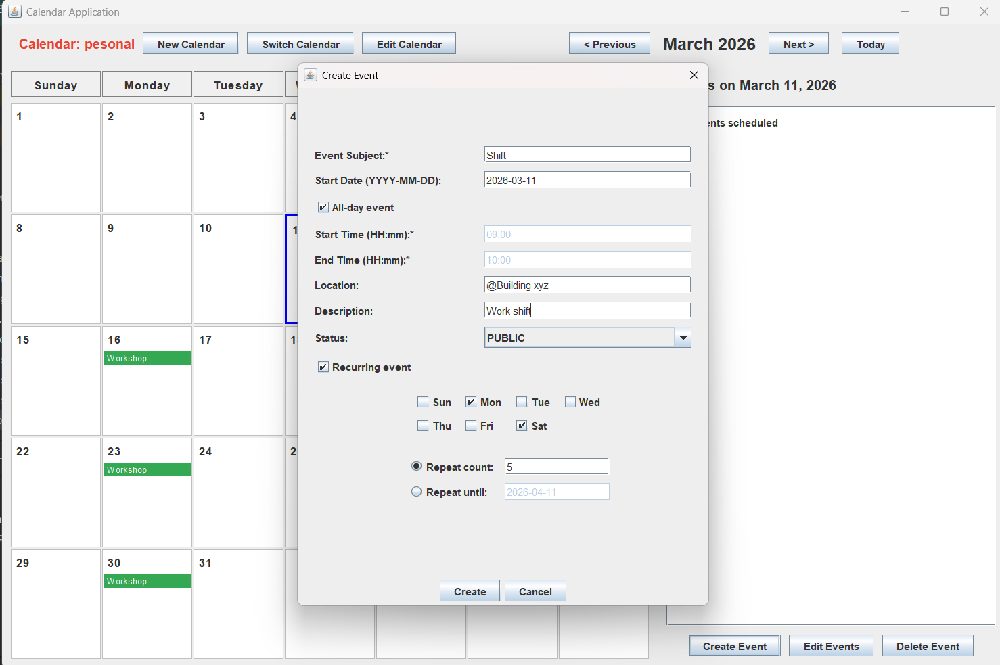
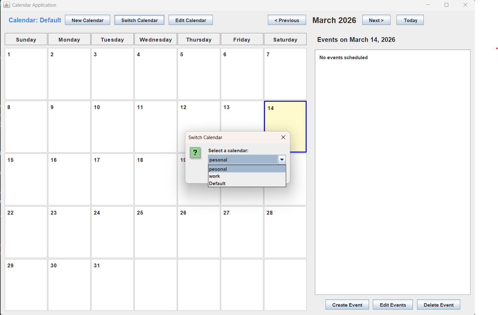
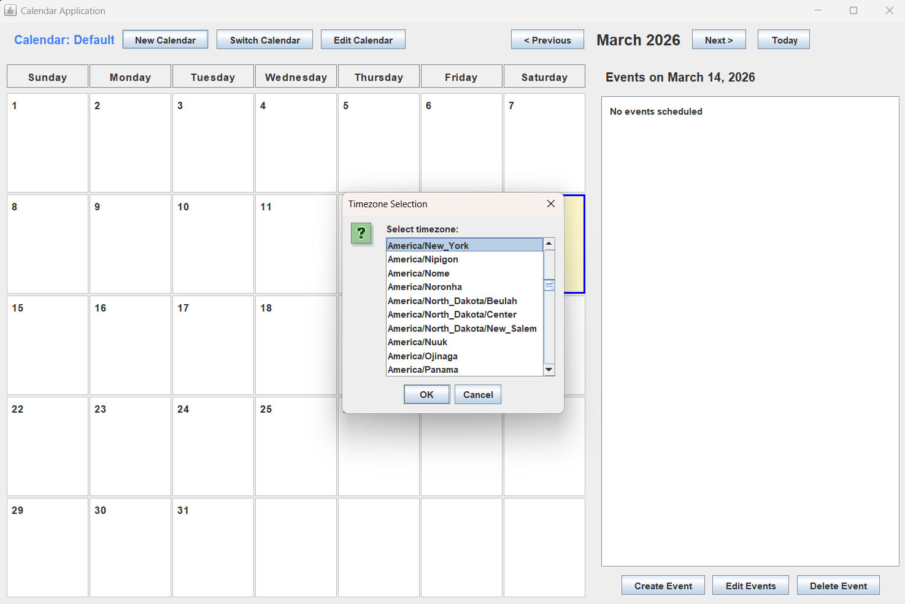

# 📅 Calendar Application

A feature-rich, multi-calendar scheduling application built in Java with support for GUI, interactive CLI, and headless
scripting modes. Designed with clean MVC architecture and comprehensive testing (95% branch coverage, 97% mutation
score).

## ✨ Features

### Core Functionality

- **Multiple Calendars**: Create and manage multiple calendars with unique names and timezones
- **Flexible Event Creation**: Single events, all-day events, and recurring event series
- **Smart Recurring Events**: Repeat on specific weekdays with customizable frequency or end date
- **Advanced Editing**: Edit single instances, future events, or entire series with automatic detachment logic
- **Cross-Calendar Operations**: Copy events between calendars with automatic timezone conversion
- **Conflict Detection**: Prevents duplicate bookings across calendars
- **Multiple Export Formats**: Export to CSV or iCal format (Google Calendar compatible)
- **Timezone Support**: Full IANA timezone database support with automatic conversions

### Three Modes of Operation

1. **GUI Mode**: Interactive graphical interface with monthly calendar view
2. **Interactive CLI**: Text-based command-line interface for manual operation
3. **Headless Mode**: Batch execution from script files for automation

## 🖼️ Screenshots

### Class Diagram


### GUI Mode


*Monthly calendar view with event management sidebar*

### Event Creation


*Event creation dialog with recurring options*

### Multi-Calendar Support



*Manage multiple calendars with different timezones*

## 🚀 Quick Start

### Prerequisites

- Java Development Kit (JDK) 11 or higher
- Gradle (wrapper included)

### Building the Application

Clone the repository and build the JAR:

```bash
git clone https://github.com/teja1412-hub/calendar-application.git
cd calendar-application
./gradlew jar
```

The JAR file will be created in `build/libs/calendar-1.0.jar`

### Running the Application

#### GUI Mode (Default)

```bash
java -jar build/libs/calendar-1.0.jar
```

Or simply double-click the JAR file.

#### Interactive CLI Mode

```bash
java -jar build/libs/calendar-1.0.jar --mode interactive
```

#### Headless/Script Mode

```bash
java -jar build/libs/calendar-1.0.jar --mode headless res/commands.txt
```

## 📖 Usage Guide

### GUI Mode

#### Calendar Management

**Create a New Calendar:**

1. Click **"New Calendar"** button
2. Enter calendar name
3. Select timezone from dropdown (e.g., America/New_York)
4. Click **OK**

**Switch Between Calendars:**

1. Click **"Switch Calendar"** button
2. Select desired calendar from list
3. Click **OK**

- Current calendar name displays with unique color coding

**Edit Calendar Properties:**

1. Click **"Edit Calendar"** button
2. Choose property to edit (name or timezone)
3. Enter/select new value
4. Click **"Save Changes"**

#### Event Management

**Create a Single Event:**

1. Click on desired date in calendar grid
2. Click **"Create Event"** in right sidebar
3. Fill in event details:
    - Subject (required)
    - Start/End times (HH:mm format, 24-hour)
    - Location (optional)
    - Description (optional)
    - Status (PUBLIC/PRIVATE)
4. For all-day events, check **"All-day event"** checkbox
5. Click **"Create"**

**Create a Recurring Event:**

1. Click desired date → **"Create Event"**
2. Fill in basic event information
3. Check **"Recurring event"** checkbox
4. Select weekdays: Sun, Mon, Tue, Wed, Thu, Fri, Sat
5. Choose recurrence end condition:
    - **Repeat count**: Enter number of occurrences
    - **Repeat until**: Enter end date (YYYY-MM-DD)
6. Click **"Create"**

**Edit Events:**

1. Select date containing the event
2. Click **"Edit Events"**
3. Choose event from dropdown
4. Modify desired fields
5. For recurring events, select edit scope:
    - **"This event only"**: Affects single occurrence
    - **"This and future events"**: Affects from this date forward
    - **"All events in series"**: Affects entire series
6. Click **"Save Changes"**

**Delete Events:**

1. Select date → Click **"Delete Event"**
2. Choose event from dropdown
3. Select deletion scope (for recurring events)
4. Confirm deletion

- Event is permanently removed

#### Navigation

**Month Navigation:**

- **"< Previous"**: Go to previous month
- **"Next >"**: Go to next month
- **"Today"**: Return to current month

**Date Selection:**

- Click any date to view its events in right sidebar
- Selected date highlighted with blue border
- Today's date has yellow background

### CLI Mode

#### Calendar Commands

```bash
# Create a calendar
create calendar --name Work --timezone America/New_York

# Select active calendar
use calendar --name Work

# Edit calendar properties
edit calendar --name Work --property name Office
edit calendar --name Work --property timezone America/Chicago
```

#### Event Commands

```bash
# Single timed event
create event "Team Meeting" from 2025-05-05T10:00 to 2025-05-05T11:00

# All-day event
create event "Birthday Party" on 2025-05-15

# Recurring event (with count)
create event "Daily Standup" from 2025-05-05T09:00 to 2025-05-05T09:30 repeats MTWRF for 20 times

# Recurring event (until date)
create event "Weekly Review" from 2025-05-02T14:00 to 2025-05-02T15:00 repeats F until 2025-12-31

# Recurring all-day event
create event Gym on 2025-05-06 repeats MWF for 30 times
```

**Weekday Codes:**

- M = Monday, T = Tuesday, W = Wednesday, R = Thursday
- F = Friday, S = Saturday, U = Sunday

#### Editing Events

```bash
# Edit single event
edit event subject Meeting from 2025-05-05T10:00 to 2025-05-05T11:00 with "Sprint Planning"

# Edit from point forward in series
edit events location "Daily Standup" from 2025-05-12T09:00 with "Conference Room B"

# Edit entire series
edit series subject "Weekly Review" from 2025-05-02T14:00 with "Team Retrospective"
```

**Editable Properties:**

- `subject`, `start`, `end`, `description`, `location`, `status`

#### Copy Operations

```bash
# Copy single event
copy event "Team Meeting" on 2025-05-05T10:00 --target Personal to 2025-05-06T14:00

# Copy all events on a date
copy events on 2025-05-05 --target Personal to 2025-05-10

# Copy events in date range
copy events between 2025-09-05 and 2025-12-18 --target Spring2026 to 2026-01-08
```

*Note: Times automatically convert between calendar timezones*

#### Query Commands

```bash
# View events on specific date
print events on 2025-05-05

# View events in time range
print events from 2025-05-05T08:00 to 2025-05-10T18:00

# Check availability
show status on 2025-05-05T14:30
# Returns: Busy or Available
```

#### Export Commands

```bash
# Export to CSV (Google Calendar compatible)
export cal work_calendar.csv

# Export to iCal format
export cal work_calendar.ical
```

*Format automatically detected by file extension. Absolute path displayed after export.*

#### Exit

```bash
exit
```

### Complete Example Session

```bash
$ java -jar build/libs/calendar-1.0.jar --mode interactive

Calendar started. Enter commands (type 'exit' to quit): 

create calendar --name Work --timezone America/New_York
Calendar 'Work' created successfully with timezone America/New_York

use calendar --name Work
Now using calendar: Work

create event "Team Meeting" from 2025-05-05T10:00 to 2025-05-05T11:00
Event created successfully.

create event "Daily Standup" from 2025-05-05T09:00 to 2025-05-05T09:30 repeats MTWRF for 10 times
Event series created successfully with 10 events.

print events on 2025-05-05
Daily Standup starting on 2025-05-05 at 09:00 ending on 2025-05-05 at 09:30, Status: PUBLIC
Team Meeting starting on 2025-05-05 at 10:00 ending on 2025-05-05 at 11:00, Status: PUBLIC

export cal work_calendar.csv
Calendar exported successfully to: /absolute/path/exports/work_calendar.csv

exit
Calendar has been terminated.
```

## 🏗️ Architecture

### Design Patterns

Built following **MVC (Model-View-Controller)** architecture with strategic design patterns:

- **MVC Pattern**: Clean separation between data model, user interface, and control logic
- **Chain of Responsibility**: CLI command validation pipeline
- **Facade Pattern**: Simplified export operations (CSV/iCal)
- **Command Pattern**: Undo functionality support
- **Adapter Pattern**: Multi-calendar and timezone abstraction
- **Observer Pattern**: View synchronization (GUI updates)

### Project Structure

```
calendar-application/
├── src/
│   ├── main/
│   │   └── java/
│   │       ├── CalendarRunner.java          # Main entry point
│   │       └── calendar/
│   │           ├── controller/              # Controllers for different modes
│   │           ├── model/                   # Core business logic
│   │           └── view/                    # User interfaces
│   └── test/                                # Comprehensive test suite
│       ├── controller/                      # Controller tests with mocks
│       ├── model/                           # Model unit tests
│       └── integration/                     # Integration tests
├── res/
│   ├── commands.txt                         # Sample command script
│   └── invalid.txt                          # Invalid command examples
├── exports/                                 # Generated export files
├── build.gradle                             # Gradle build configuration
└── README.md                                # This file
```

### Data Structures

**Event Storage:**

- **Primary:** `Map<LocalDate, List<Event>>` for efficient date-based lookups
- **Alternative Explored:** TreeMap for O(log n) sorted operations
- **Choice Rationale:** Map provides O(1) average-case lookups for date queries, which represents the most common
  operation (viewing events on a specific date). While TreeMap offers O(log n) sorted iteration, the added complexity
  wasn't justified for our use case where date-based access patterns dominate.

**Recurring Events:**

- Series metadata stored separately with detachment tracking
- Individual instances generated on-demand
- Edit operations intelligently split series when start times change

**Scalability Considerations:**
For production-scale deployment (10,000+ events), consider:

- **Lazy loading**: Generate recurring instances on-demand rather than pre-computing
- **Index structures**: B-tree or skip list for range queries
- **Database backing**: Replace in-memory storage with SQLite/PostgreSQL for persistence
- **Caching layer**: LRU cache for frequently accessed date ranges

## 🧪 Testing

### Test Coverage
_(The test coverage excludes the view as we cannot test the GUI with automated testing.)_
- **Branch Coverage**: 95%
- **Mutation Score**: 97% (PIT mutation testing)
- **Test Cases**: 600+ comprehensive tests

### Testing Strategy

- **Model Tests**: Comprehensive unit tests for all business logic
- **Controller Tests**: Mock-based testing for user interaction flows
- **Integration Tests**: End-to-end command execution validation
- **Edge Cases**: Timezone conflicts, series mutations, calendar consistency

### Running Tests

```bash
# Run all tests
./gradlew test

# Generate coverage report
./gradlew jacocoTestReport

# Run mutation testing
./gradlew pitest
```

Coverage reports available in `build/reports/jacoco/test/html/index.html`

## 🔧 Technical Details

### Date & Time Formats

**In CLI/Script Mode:**

- Date: `YYYY-MM-DD` (e.g., 2025-05-05)
- DateTime: `YYYY-MM-DDTHH:mm` (e.g., 2025-05-05T14:30)
- Time: 24-hour format

**In GUI Mode:**

- Date fields: `YYYY-MM-DD`
- Time fields: `HH:mm` (24-hour)

### Timezone Support

Uses Java's `ZoneId` with IANA timezone database:

- Americas: `America/New_York`, `America/Chicago`, `America/Los_Angeles`
- Europe: `Europe/London`, `Europe/Paris`, `Europe/Berlin`
- Asia: `Asia/Tokyo`, `Asia/Kolkata`, `Asia/Shanghai`
- And 500+ more...

### Constraints & Validation

- **Unique Events**: No two events can have identical subject, start time, and end time
- **Calendar Names**: Must be unique across all calendars
- **Time Validation**: End time must be after start time
- **Recurring Events**: Must occur on at least one weekday
- **Series Integrity**: Start time changes create new series (automatic detachment)

## 📂 File Formats

### CSV Export (Google Calendar Compatible)

Exported CSV files follow Google Calendar import format and can be directly imported.

**Verification:**

1. Export calendar: `export cal my_events.csv`
2. Go to Google Calendar → Settings → Import & Export
3. Select exported CSV file
4. Events should appear in your Google Calendar

### iCal Export

Standard iCalendar format (.ical) compatible with:

- Google Calendar
- Apple Calendar
- Outlook
- Any RFC 5545 compliant calendar application

## 🎯 Use Cases

### Academic Scheduling

```bash
# Create semester calendar
create calendar --name "Fall 2025" --timezone America/New_York
use calendar --name "Fall 2025"

# Add recurring lectures
create event "CS 5010 Lecture" from 2025-09-08T10:00 to 2025-09-08T11:30 repeats TR until 2025-12-18

# Copy to next semester
create calendar --name "Spring 2026" --timezone America/New_York
copy events between 2025-09-08 and 2025-12-18 --target "Spring 2026" to 2026-01-13
```

### Work Calendar Management

```bash
# Create work calendar
create calendar --name Work --timezone America/Chicago

# Regular meetings
create event "Team Standup" from 2025-05-05T09:00 to 2025-05-05T09:30 repeats MTWRF for 60 times

# One-time events
create event "Quarterly Review" from 2025-06-15T14:00 to 2025-06-15T16:00
```

### Personal Planning

```bash
# All-day events
create event "Vacation" on 2025-07-04
create event "Birthday" on 2025-08-15

# Recurring activities
create event "Yoga Class" from 2025-05-06T18:00 to 2025-05-06T19:00 repeats MW for 24 times
```

## 🏗️ Design Highlights

### SOLID Principles

- **Single Responsibility**: Each class has one well-defined purpose
- **Open/Closed**: Extensible through interfaces (export formats, view types)
- **Liskov Substitution**: Polymorphic view and controller implementations
- **Interface Segregation**: Focused interfaces for model, view, controller
- **Dependency Inversion**: Dependencies on abstractions, not concrete classes

### Recurring Event Logic

The application handles complex recurring event scenarios:

**Example:**

```bash
# Create series
create event "Team Sync" from 2025-05-05T10:00 to 2025-05-05T11:00 repeats MW for 6 times

# Edit subject of May 12 event and all future → affects 4 events
edit events subject "Team Sync" from 2025-05-12T10:00 with "Project Sync"

# Edit start time of May 12 event forward → creates new series (detachment!)
edit events start "Project Sync" from 2025-05-12T10:00 with 2025-05-12T10:30

# Now May 5 and May 7 form one series (10:00 start time)
# May 12, 14, 19, 21 form another series (10:30 start time)
```

*Try this in Google Calendar to see the same behavior!*

### Error Handling

**Graceful Error Management:**

- Invalid command syntax → Descriptive error message
- Timezone conflicts → Clear explanation
- Duplicate events → Conflict prevention message
- Missing calendar context → Prompt to select calendar
- Invalid dates/times → Format guidance

**GUI Validation:**

- Form field validation before submission
- Disabled invalid options
- Clear error dialogs with actionable messages

## 📋 Command Reference

### Calendar Management

| Command                                                 | Description         | Example                                                         |
|---------------------------------------------------------|---------------------|-----------------------------------------------------------------|
| `create calendar --name <name> --timezone <tz>`         | Create new calendar | `create calendar --name Work --timezone America/New_York`       |
| `use calendar --name <name>`                            | Set active calendar | `use calendar --name Work`                                      |
| `edit calendar --name <name> --property <prop> <value>` | Edit calendar       | `edit calendar --name Work --property timezone America/Chicago` |

### Event Creation

| Command                                                                             | Description               |
|-------------------------------------------------------------------------------------|---------------------------|
| `create event <subject> from <datetime> to <datetime>`                              | Single timed event        |
| `create event <subject> on <date>`                                                  | Single all-day event      |
| `create event <subject> from <datetime> to <datetime> repeats <days> for <N> times` | Recurring with count      |
| `create event <subject> from <datetime> to <datetime> repeats <days> until <date>`  | Recurring until date      |
| `create event <subject> on <date> repeats <days> for <N> times`                     | Recurring all-day (count) |
| `create event <subject> on <date> repeats <days> until <date>`                      | Recurring all-day (date)  |

### Event Editing

| Command                                                      | Scope           | Description            |
|--------------------------------------------------------------|-----------------|------------------------|
| `edit event <prop> <subject> from <dt> to <dt> with <value>` | Single instance | Edit one occurrence    |
| `edit events <prop> <subject> from <dt> with <value>`        | This and future | Edit from date forward |
| `edit series <prop> <subject> from <dt> with <value>`        | Entire series   | Edit all occurrences   |

### Cross-Calendar Operations

| Command                                                           | Description             |
|-------------------------------------------------------------------|-------------------------|
| `copy event <subject> on <datetime> --target <cal> to <datetime>` | Copy single event       |
| `copy events on <date> --target <cal> to <date>`                  | Copy all events on date |
| `copy events between <date> and <date> --target <cal> to <date>`  | Copy date range         |

### Queries & Export

| Command                                      | Description             |
|----------------------------------------------|-------------------------|
| `print events on <date>`                     | List events on date     |
| `print events from <datetime> to <datetime>` | List events in range    |
| `show status on <datetime>`                  | Check if busy/available |
| `export cal <filename.csv>`                  | Export to CSV           |
| `export cal <filename.ical>`                 | Export to iCal          |
| `exit`                                       | Terminate application   |

## 🛠️ Development

### Built With

- **Java 11+**: Core language
- **Swing**: GUI framework (Java standard library)
- **JUnit 5**: Unit testing
- **JaCoCo**: Code coverage analysis
- **PIT**: Mutation testing
- **Gradle**: Build automation

### Code Quality Metrics

- 49 classes across model, view, controller
- ~2,700 lines of production code
- 95% branch coverage
- 97% mutation score
- Zero FindBugs violations

### Running from IDE

**IntelliJ IDEA / Eclipse:**

1. Import project as Gradle project
2. Run `CalendarRunner.java` with arguments:
    - No args → GUI mode
    - `--mode interactive` → CLI mode
    - `--mode headless res/commands.txt` → Script mode

## 🤝 Contributing

This was developed as a course project for CS 5010 - Programming Design Paradigm at Northeastern University.

### Development Workflow
1. Code reviews before merging
2. Test coverage maintained above 90%
3. All features validated against Google Calendar compatibility

## 📝 License

This project was created for educational purposes as part of Northeastern University's CS 5010 course.

## 🙏 Acknowledgments

- **Course:** CS 5010 - Programming Design Paradigm, Northeastern University
- **Inspiration:** Google Calendar, Apple Calendar
- **Assignment Design:** Northeastern University Khoury College faculty

## 📧 Contact

**Teja Vejandla**

- Email: vejandla.03@gmail.com
- LinkedIn: [linkedin.com/in/bhavya-teja-vejandla](https://linkedin.com/in/bhavya-teja-vejandla)
- GitHub: [github.com/teja1412-hub](https://github.com/teja1412-hub)

---

## 🔍 Technical Deep Dive

### Recurring Event Implementation

The application implements sophisticated recurring event logic with automatic series detachment:

**Scenario:** User creates recurring "Standup" M/W/F, then changes start time for one instance.

**Result:**

- Original series: Events keeping 10:00 start time
- New series: Events with modified 10:30 start time
- Both series maintain their recurrence patterns independently

This matches Google Calendar's behavior and demonstrates complex state management.

### Timezone Handling

**Challenge:** Display events correctly when copying between timezones

**Solution:**

- Store all events with associated timezone
- Convert on-the-fly when copying to different calendar
- Example: 2:00 PM EST → 11:00 AM PST (automatic conversion)

**Implementation:**

```java
// Pseudocode
ZonedDateTime sourceTime = event.getStartTime();
ZonedDateTime targetTime = sourceTime.withZoneSameInstant(targetCalendar.getZoneId());
```

### Conflict Detection

**Algorithm:**

- Check for overlapping events on event creation/edit
- Compare: subject, start time, end time
- Prevent: Exact duplicates across all calendars
- Allow: Same subject at different times

### Data Structure Analysis

**Current Implementation:**

- `Map<LocalDate, List<Event>>` for event storage
- O(1) average lookup by date
- O(n) iteration for date ranges

**Scalability Considerations:**

For 10,000+ events:

- **TreeMap**: O(log n) lookups, O(log n) range queries
- **B-tree**: Optimal for disk-based storage
- **Database**: PostgreSQL with proper indexing for production scale

**Trade-offs:**

| Structure | Lookup | Range Query | Memory | Best For |
|-----------|--------|-------------|--------|----------|
| HashMap | O(1) | O(n) | Medium | Current use case |
| TreeMap | O(log n) | O(log n) | Medium | 1K-10K events |
| B-tree | O(log n) | O(log n) | Low | 10K+ events, disk-based |
| Database | O(log n) | O(log n) | Minimal | Production, persistence |

## 🐛 Known Limitations

- **In-memory only**: Events lost on application exit (no persistence)
- **Single user**: No multi-user support or concurrent access
- **No reminders**: Notification system not implemented
- **Limited views**: Only monthly view (weekly/daily views not included)
- **No attachments**: Cannot attach files to events

## 🚀 Future Enhancements

- [ ] Event persistence (database or file storage)
- [ ] Weekly and daily calendar views
- [ ] Event reminders and notifications
- [ ] Event attachments and notes
- [ ] Search and filter functionality
- [ ] Event categories/tags with color coding
- [ ] Import from CSV/iCal
- [ ] Multi-user support with permissions
- [ ] Mobile-responsive web interface
- [ ] Integration with external calendars (Google Calendar API)

---

**⭐ If you found this project useful, please star the repository!**
